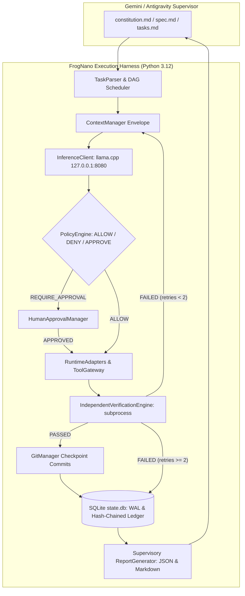

# FrogNano Autonomous Execution Harness

[]()
[]()
[]()
[]()
[-success.svg)]()

A lightweight, zero-cloud, crash-resilient agentic coding execution harness designed to autonomously execute and independently verify SpecKit task graphs on Windows 11 using a locally hosted `llama.cpp` model (FrogNano-4B / Qwen-2.5-Coder-7B).

---

## 🏛️ Constitutional Engineering Principle

> **Gemini plans. SpecKit structures. Python orchestrates. FrogNano implements. The Policy Engine authorizes. The Runtime executes. The Verification Engine verifies. The Audit Ledger remembers.**

### Key Constitutional Invariants
- **Zero Paid APIs**: Operates 100% locally on Windows 11 with consumer hardware (NVIDIA RTX 4060 8 GB VRAM). Never makes paid or external API calls.
- **Python Standard Library First**: Powered by standard library primitives (`sqlite3`, `urllib.request`, `subprocess`, `hashlib`, `pathlib`). No microservices, web frameworks, or heavyweight runtime dependencies.
- **Strict Sandbox Boundaries**: The model never has direct shell or filesystem access. All actions are requested through structured tool calls, authorized deterministically by the Policy Engine, executed by isolated runtime adapters, and verified independently.
- **Bounded Autonomy**: Maximum 2 retries per task. On exhaustion, the task transitions to `BLOCKED`, cascading only to direct/transitive dependents while allowing independent DAG branches to continue.
- **Immutable Ledger**: Every tool request, decision, execution outcome, and Git checkpoint is permanently recorded in a SHA-256 hash-chained SQLite ledger with automatic secret scrubbing.

---

## 🏗️ Architecture & Component Flow



---

## ⚡ Quickstart

### Prerequisites
1. **Operating System**: Windows 11 (`pwsh` / PowerShell 7+).
2. **Python**: Python 3.11+ installed.
3. **Local Inference Server**: `llama.cpp` server running on port 8080 serving OpenAI API emulation:
   ```powershell
   llama-server -m models/frognano-4b.gguf -c 65536 --port 8080
   ```

### Installation
```powershell
git clone https://github.com/Vaing/Frognano-harness.git
cd Frognano-harness
pip install -e .
```

### Running the Test Suite
Run all 67 contract, unit, and integration tests:
```powershell
python -m pytest -v
```

---

## 🕹️ CLI Command Reference (All 14 Commands)

The harness is driven via `harness` (or `python -m frognano_harness.cli`):

| Command | Syntax | Description |
| :--- | :--- | :--- |
| `init` | `harness init [--endpoint <url>] [--model <alias>] [--force]` | Initialize `.harness/` directory, SQLite database with WAL mode, and `config.json`. |
| `validate` | `harness validate [--tasks <path>] [--json]` | Discover and validate `tasks.md`, contract fields, and check for cyclic dependencies with Kahn's algorithm. |
| `plan` | `harness plan [--tasks <path>] [--ascii] [--json]` | Compute and display the topological execution DAG and parallelizable branches. |
| `run` | `harness run [--task <id>] [--max-retries <n>] [--unattended]` | Execute ready tasks in sequential topological order with model dispatch and verification. |
| `resume` | `harness resume [--run-id <id>] [--unattended]` | Reconcile SQLite state against Git history, reset interrupted tasks, and resume execution. |
| `status` | `harness status [--json] [--watch]` | Display real-time progress: completed, running, pending, blocked tasks, and approvals. |
| `task` | `harness task <task_id> [--json]` | Inspect a specific task envelope, objective, allowed files, and execution attempt history. |
| `retry` | `harness retry <task_id> [--force]` | Reset retry count to 0 and re-queue a `BLOCKED` or `FAILED` task to `READY`. |
| `approve` | `harness approve <approval_id>` | Authorize a high-risk tool operation held by the Human Approval Manager. |
| `reject` | `harness reject <approval_id> [--reason <text>]` | Reject a pending high-risk tool operation with optional rationale. |
| `report` | `harness report [--output <dir>] [--format json\|md\|both]` | Export structured JSON and human-readable Markdown supervisory reports to `.harness/reports/`. |
| `logs` | `harness logs <task_id> [--tail <n>] [--tool <name>]` | View structured execution traces, model completions, and tool outputs for a task. |
| `verify` | `harness verify <task_id> [--all]` | Independently re-run verification commands without model invocation. |
| `audit` | `harness audit [--verify-chain] [--tool-call <id>] [--json]` | Verify cryptographic SHA-256 hash chain integrity across all audit records and inspect events. |

---

## 🛡️ Security & Zero-Trust Tooling

### Tool Gateway
The model interacts with the workspace exclusively through pre-registered tool schemas:
- `read_file(path, offset, limit)`: Read text within workspace boundaries.
- `list_files(directory, recursive)`: Inspect workspace hierarchy.
- `search_code(query, path, file_pattern)`: Search for regex patterns across code.
- `write_file(path, content, overwrite)`: Write files confined to `allowed_files`.
- `apply_patch(path, patch)`: Apply unified diff patches.
- `run_command(command, args, timeout)`: Execute whitelisted build/test commands.
- `run_tests(test_command, args)`: Run test suite via subprocess.
- `git_status()`, `git_diff()`, `git_commit()`: Local version control operations (never pushes).

### Policy Engine Enforcement
1. **Path Traversal Prohibited**: Normalized paths resolving outside the project root are rejected with `PATH_OUTSIDE_WORKSPACE`.
2. **Secrets Protected**: Files matching `.env*`, `*.pem`, `*.key`, `id_rsa`, or `.git/` are strictly blocked.
3. **Declared File Boundaries**: Modifying files not listed in a task's `allowed_files` triggers an immediate policy denial.
4. **Human Authorization Interception**: Destructive commands (`rm`, `git reset --hard`) and package installations require explicit interactive operator approval `[y/N]` or CLI approval.

---

## 🔄 Crash Resiliency & Session Recovery

The harness is engineered to survive terminal closures, abrupt crashes, power loss, and reboots:
1. **SQLite WAL Mode**: Write-Ahead Logging (`PRAGMA journal_mode = WAL`) guarantees ACID persistence without corruption.
2. **Atomic Git Checkpoints**: Every successfully verified task produces an individual commit: `[<task_id>] <title>`.
3. **Resumption Reconciliation**: Running `harness resume` reconciles SQLite records with `git cat-file -e <hash>^{commit}`:
   - Tasks verified in Git remain `COMPLETED`.
   - Tasks interrupted mid-execution (`RUNNING` / `VERIFYING`) are reset to `READY`.
   - Tasks missing commit records are reset for re-execution.
   - Execution seamlessly resumes from the exact next ready task in topological order.

---

## 📊 Supervisory Reporting for Gemini

Machine-readable supervisory reports are automatically exported to `.harness/reports/` conforming to `specs/002-local-execution-harness/contracts/report-schema.json`.

Gemini / Antigravity can inspect these reports asynchronously to monitor progress, understand failure diagnostics, and replan:
- **Task Metrics**: Total, completed, blocked, failed, pending, and progress percentage.
- **Checkpoints**: Commit hashes and completion timestamps.
- **Blocked Analysis**: Exact test failure stderr snippets and cascaded blocked dependent task IDs.
- **Actionable Next Steps**: Deterministic recommendations for supervisory intervention.

---

## 📄 License

MIT License. Built with ❤️ for local-first autonomous agentic development.
