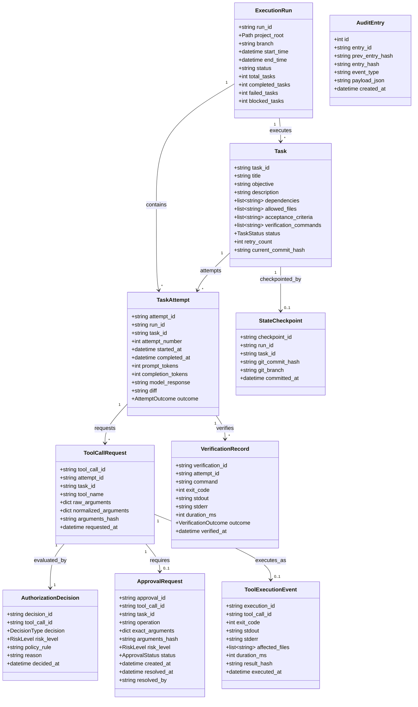
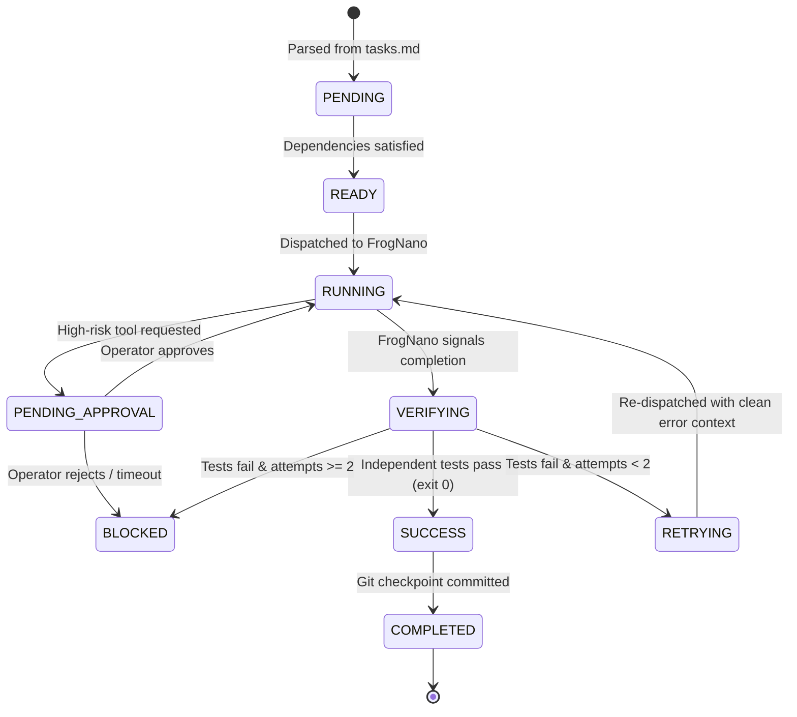

# Data Model: Local Agentic Coding Execution Harness

**Feature Branch**: `002-local-execution-harness`
**Date**: 2026-11-01
**Spec**: [spec.md](./spec.md)

This document formalizes the domain entities, relationships, state machines, validation rules, and SQLite storage schemas for the Local Agentic Coding Execution Harness.

---

## 1. Entity Overview & Class Diagram



---

## 2. Enumerations & State Machines

### 2.1 Task Lifecycle Status (`TaskStatus`)



### 2.2 Policy Decision & Risk Levels

- **`DecisionType`**:
  - `ALLOW`: Permitted to execute automatically without operator intervention.
  - `DENY`: Unconditionally blocked; violates sandbox, security rules, or task file bounds.
  - `REQUIRE_APPROVAL`: Suspended until explicit human approval is granted.

- **`RiskLevel`**:
  - `LOW`: Read-only operations within `allowed_files` (`read_file`, `list_files`, `search_code`, `git_status`, `git_diff`).
  - `MEDIUM`: Reversible write operations within pre-declared `allowed_files` (`write_file`, `apply_patch`), running allowlisted tests (`run_tests`).
  - `HIGH`: File deletions, package management, executing unlisted commands via `run_command`, modifying repository settings, or touching external paths.

- **`ApprovalStatus`**:
  - `PENDING`: Awaiting operator resolution.
  - `APPROVED`: Explicitly authorized by human operator.
  - `REJECTED`: Explicitly rejected by human operator.
  - `EXPIRED`: Prompt timed out in unattended session (defaults to rejection/suspension).

- **`VerificationOutcome`**:
  - `PASSED`: All verification commands exited with code 0 and all modified files are within `allowed_files`.
  - `FAILED`: Non-zero exit code or diff outside allowed boundaries.
  - `INCOMPLETE`: Output was truncated or execution timed out.
  - `NEEDS_HUMAN_REVIEW`: Ambiguous verification output requiring supervisory inspection.

---

## 3. Entity Details & Schema Definitions

### 3.1 Task Execution Envelope (`Task`)
The structured unit of work dispatched to FrogNano.

| Field | Type | Description | Validation Rules |
|-------|------|-------------|------------------|
| `task_id` | `str` | Unique identifier (e.g., `T-001`) | Format: `^[A-Z0-9_-]+$` |
| `title` | `str` | Short task title | Max 120 chars |
| `objective` | `str` | Primary task goal | Required, non-empty |
| `description` | `str` | Detailed requirements | Required |
| `dependencies` | `list[str]` | Prerequisite task IDs | Must exist in DAG, no circular dependencies |
| `allowed_files` | `list[str]` | Permitted read/write file paths | Must be relative to project root |
| `acceptance_criteria`| `list[str]` | Verifiable conditions of success | Required, at least 1 criterion |
| `verification_commands`| `list[str]` | Exact shell commands to verify | Required, at least 1 command |
| `status` | `TaskStatus` | Current lifecycle state | Defaults to `PENDING` |
| `retry_count` | `int` | Number of failed attempts | $0 \le \text{retry\_count} \le 2$ |

### 3.2 Audit Ledger Record (`AuditEntry`)
Immutable, hash-linked cryptographic ledger record.

| Field | Type | Description | Hash Computation |
|-------|------|-------------|------------------|
| `id` | `int` | Monotonic auto-increment ID | SQLite primary key |
| `entry_id` | `str` | UUID v4 for the event | Unique index |
| `prev_entry_hash` | `str` | SHA-256 hash of previous record | First record uses `0000...0000` (64 zeros) |
| `event_type` | `str` | Event classification | e.g., `TOOL_CALL`, `DECISION`, `APPROVAL`, `VERIFY` |
| `payload_json` | `str` | Canonical serialized JSON payload | Keys sorted, separators `(',', ':')`, secrets scrubbed |
| `created_at` | `str` | ISO 8601 UTC timestamp | Format: `YYYY-MM-DDTHH:MM:SS.fffZ` |
| `entry_hash` | `str` | `SHA256(prev_entry_hash + event_type + payload_json + created_at)` | Verifiable cryptographic chain |

---

## 4. SQLite Schema Mapping

The database schema is defined in [sqlite-schema.sql](./contracts/sqlite-schema.sql).

- **Location**: `.harness/state.db`
- **PRAGMAs**:
  ```sql
  PRAGMA foreign_keys = ON;
  PRAGMA journal_mode = WAL;
  PRAGMA synchronous = NORMAL;
  ```
- **Tables**:
  1. `schema_migrations`: Version tracking.
  2. `execution_runs`: Run metadata, status, task counts.
  3. `tasks`: Extracted tasks, states, dependencies JSON, allowed files JSON.
  4. `task_attempts`: Execution attempts, tokens, response traces.
  5. `tool_calls`: Requested tool calls, normalized arguments, hashes.
  6. `authorizations`: Policy decisions, risk classifications.
  7. `approvals`: Human approval requests, states, resolution timestamps.
  8. `tool_executions`: Executed tool outputs, exit codes, durations.
  9. `verifications`: Verification command outcomes, logs.
  10. `checkpoints`: Git commit associations.
  11. `audit_events`: Hash-linked immutable audit log.
